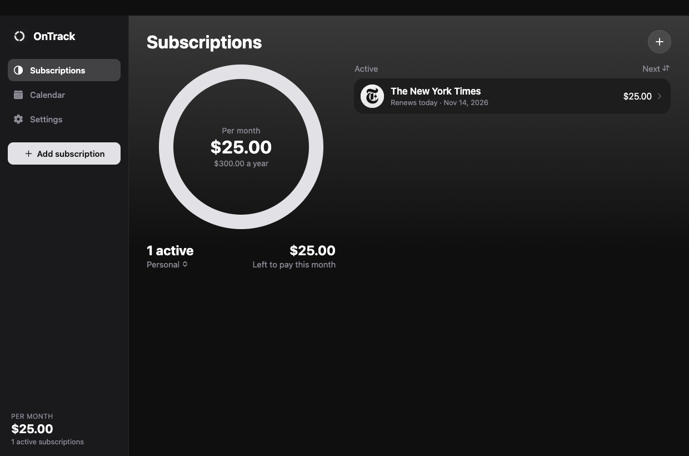
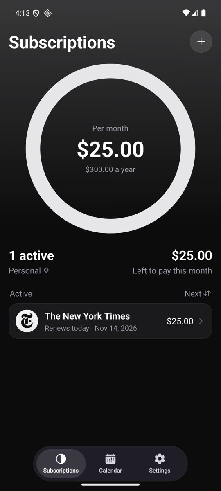

<p align="center"></p>

<h1 align="center">OnTrack</h1>
<p align="center">Keep your subscriptions on track: see what you spend, when each payment is due, and get reminded before it happens.<br>macOS · Windows · Linux · iPhone · Android</p>

<p align="center">
  
  &nbsp;
  
</p>

## Features

- **Spending ring**: every active subscription is a slice of a ring sized by what it costs, with your total per month in the middle (tap a slice to see it)
- **Calendar** of every payment, with each month's total and what's still to come
- **Add in seconds**: 120+ popular services, *type or paste* ("Netflix 15.99 monthly, Spotify $11.99/mo on the 3rd"), or import screenshots and bank statements (CSV everywhere, PDF on desktop). Text is read on your device.
- **Everything a subscription has**: price and currency, payment date, cycle (every N days/weeks/months/years) or one-time, duration, free trials, lists (Personal, Business…), categories, payment methods, URL and notes
- **Official brand logos** from [SVGL](https://svgl.app), or any website's icon, an icon, an emoji or your own picture
- **Themes and wallpapers**: 8 colour themes, built-in wallpapers or your own photo
- **Made for each screen**: a sidebar and side-by-side panes on desktop, a tab bar on phones
- **Reminders** before payments (same day to 2 weeks before)
- **Billing and price history**
- **30+ currencies** with daily exchange rates
- **Sync with Google**: the same subscriptions on every device, kept in a private app folder in your own Google Drive
- **Backups** (JSON) and spreadsheet export (CSV)
- **In-app updates** from this repo's Releases

## Download

Get the latest version from [Releases](https://github.com/Deli5150/ontrack/releases/latest):

| Platform | File |
| --- | --- |
| macOS (Apple silicon and Intel) | `OnTrack-<version>.dmg`. The app is ad-hoc signed: the first time, right-click → Open. |
| Windows | `OnTrack-Setup-<version>.exe` |
| Linux | `OnTrack-<version>-x86_64.AppImage` (`chmod +x`, then run) |
| Android | `OnTrack-<version>.apk` (allow installing unknown apps) |
| iPhone | Build it yourself and sideload (see below). |

## Feedback

Found a bug or have an idea? In the app, open **Settings → Report a bug or request a feature**: it fills in a GitHub issue (with your OnTrack version and device) for you to send. Or open an issue directly: [report a bug](https://github.com/Deli5150/ontrack/issues/new?template=bug.yml) · [request a feature](https://github.com/Deli5150/ontrack/issues/new?template=feature.yml).

## How it's built

One React Native (Expo SDK 58) codebase:

- **iOS and Android** are the Expo app (`App.tsx`, `src/`).
- **Desktop** is the same app exported for the web and wrapped in Electron (`desktop/`). The Electron side adds a JSON data file, reminders as system notifications (OnTrack keeps running in the background, or in the tray on Windows/Linux), screenshot text recognition (Tesseract), PDF reading (pdf.js), Google sign-in and the updater.

```
App.tsx              navigation and startup
src/lib/             data model, store, date math, parsers, importers, reminders, sync, updater
src/screens/         Subscriptions, Calendar, Settings, the add/edit flow
src/ui/              themes, shared components, the spending ring, sidebar, pop-ups
desktop/             Electron: main.cjs, preload.cjs, updater.cjs, google.cjs
modules/ontrack-updater   Android: opens the system installer on a downloaded APK
scripts/             desktop build, iOS build, release, icon rendering
```

## Developing

```sh
npm install && (cd desktop && npm install)
npm start            # Expo dev server (phones / web)
npm run desktop      # build the web export and open the desktop app
npm test             # unit tests (dates, parsers, sync)
npm run typecheck
```

## Building

```sh
npm run dist:desktop     # dist/: .dmg + -mac.zip, Setup .exe, .AppImage
npx expo prebuild --platform android && npm run dist:android    # APK
npm run dist:ios         # dist/OnTrack-<version>.ipa (needs Xcode and APPLE_TEAM_ID in .env)
npm run release          # publish a GitHub Release with everything in dist/ (notes from CHANGELOG.md)
```

The version lives only in `package.json`. Android release builds are signed with the key named by `ONTRACK_RELEASE_*` in `~/.gradle/gradle.properties`, so every APK installs over the last one.

### In-app updates

Every install checks this repo's latest release (at launch and every few hours). A new version brings up an **Update available** sheet (Release Notes, Update, Later for a day, or Skip this version), and Settings → Updates has it too:

- **macOS**: downloads the `-mac.zip`, swaps the app and restarts
- **Windows**: runs the new installer silently and restarts
- **Linux**: replaces the AppImage and restarts
- **Android**: downloads the APK and opens the system installer
- **iPhone**: Update opens a chooser: **AltStore**, **SideStore**, **Feather** or **FlareStore** installs the new `.ipa` straight from the release, or **Download IPA** saves it for manual sideloading (iOS can't install apps itself)

### Sync with Google

Official builds use the **OnTrack** Google Cloud project (`ontrack-514720`, published, scopes `drive.appdata` and `userinfo.email`; its home, privacy and terms pages are `docs/`, served at https://deli5150.github.io/ontrack/). To build your own, sync uses OAuth clients from a Google Cloud project with the **Google Drive API** enabled and the `drive.appdata` scope on its consent screen. Put them in `.env` (not committed):

```sh
ONTRACK_GOOGLE_CLIENT_ID=...            # "Desktop app" client (desktop)
ONTRACK_GOOGLE_CLIENT_SECRET=...
EXPO_PUBLIC_GOOGLE_IOS_CLIENT_ID=...    # "iOS" client, bundle ID app.ontrack.subscriptions
```

Android needs an **Android** client in the same project for package `app.ontrack.subscriptions` with your release key's SHA-1 (`keytool -list -v -keystore credentials/ontrack-release.keystore`); it needs no ID in `.env`.

Each device merges with the file in Drive: every subscription, list, category, payment method and synced setting keeps the time it last changed, the newest change wins, and deletions are remembered so they reach every device.

## Privacy

Your data stays on your devices (and in your own Google Drive if you turn on Sync). OnTrack fetches brand logos (SVGL through jsDelivr, and Google's favicon service), exchange rates (open.er-api.com) and update information (GitHub). Nothing else leaves your device.

## License

MIT
